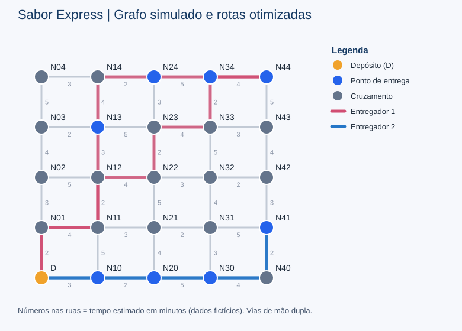

# Rota Inteligente: Otimização de Entregas com Algoritmos de IA

**Disciplina:** Artificial Intelligence Fundamentals  
**Aluno:** Felipe Cavalcante Marinho | **RA:** 159820 | **Curso:** GTI  
**Empresa fictícia:** Sabor Express

| Entregável | Link |
|---|---|
| Repositório público (GitHub) | https://github.com/christiandino/Rota-Inteligente-Otimiza-o-de-Entregas-com-Algoritmos-de-ia-/edit/main/rota_inteligente/README.md
| Vídeo pitch (YouTube, até 4 min) |https://youtu.be/T5LzDSe6MNo

## 1. Problema e objetivos
A Sabor Express, delivery de alimentos da região central, define os trajetos manualmente, com base apenas na experiência dos entregadores. Nos horários de pico (almoço e jantar) isso gera percursos longos, atrasos, mais gasto de combustível e clientes insatisfeitos.

**Objetivos:**
1. Modelar a malha viária como **grafo ponderado** (nós = locais/cruzamentos; arestas = ruas; peso = minutos estimados).
2. Encontrar o **menor caminho** entre dois pontos com algoritmo de busca heurística (**A\***).
3. **Agrupar pedidos próximos** com aprendizado não supervisionado (**K-Means**), um grupo por entregador.
4. Definir a **melhor ordem de visita** das entregas de cada grupo e **medir o ganho** contra uma referência.

**Escopo:** simulação reproduzível com dados fictícios: depósito `D`, 25 nós em grade 5×5, 40 ruas de mão dupla e oito pedidos. O peso de cada aresta é tempo estimado (minutos), não distância real nem trânsito ao vivo. Não se reivindica redução real de combustível ou atrasos.

## 2. Abordagem e decisões
```text
CSV (nós, ruas, pedidos) → grafo ponderado → K-Means (grupos) → A* (matriz de tempos entre paradas)
→ busca exaustiva da ordem de visita → métricas + JSON + mapa SVG
```
1. `data/nodes.csv`: vértices e coordenadas fictícias (x, y).
2. `data/edges.csv`: ruas, peso positivo em minutos e indicador de mão dupla. O leitor também suporta vias de mão única (`bidirectional=false`).
3. `data/deliveries.csv`: pedidos e respectivos nós, na ordem de chegada.
4. **K-Means implementado do zero:** agrupa as entregas por proximidade euclidiana; centros iniciais determinísticos (ponto mais distante dos já escolhidos), então o resultado é sempre o mesmo. A divisão é geográfica e não garante cargas equilibradas.
5. **A\*:** busca o menor tempo entre duas paradas, com heurística `h(n) = escala × distância_euclidiana(n, destino)`, onde `escala` é o menor quociente minutos/distância entre todas as arestas. A heurística é **admissível e consistente**: toda aresta custa pelo menos `escala × comprimento`, e a distância em linha reta respeita a desigualdade triangular, logo `h` nunca superestima o custo restante.
6. **Dijkstra** confirma o custo exato do A\*; **BFS** (busca em largura) mostra que minimizar o número de ruas não é o mesmo que minimizar o tempo; **DFS** (busca em profundidade) mostra que achar *um* caminho não é achar o melhor.
7. **Matriz de custos:** o A\* é executado uma única vez para cada par de pontos (depósito + entregas) e reaproveitado em todas as permutações, o que deixa a execução instantânea.
8. **Busca exaustiva da ordem de entregas:** avalia todas as permutações de até 8 paradas por entregador, com saída e retorno ao depósito. Encontra a melhor ordem **dentro do grupo**, mas não resolve globalmente a divisão entre entregadores.
9. **Baseline:** mesmos grupos do K-Means, visitados na ordem original do CSV (ordem de chegada dos pedidos) e com retorno ao depósito. A economia é relativa a essa referência, não a uma operação real.

## 3. Algoritmos e complexidade
| Etapa | Método | Complexidade aproximada | Garante ótimo? |
|---|---|---|---|
| Menor caminho | A\* com heap | O((V+E) log V) no pior caso | Sim (heurística admissível) |
| Verificação | Dijkstra com heap | O((V+E) log V) | Sim |
| Comparação | BFS | O(V+E) | Só em número de ruas |
| Comparação | DFS | O(V+E) | Não |
| Agrupamento | K-Means | O(I × N × K), I iterações | Ótimo local |
| Ordem das paradas | Permutações | O(m! × m), m ≤ 8 (com matriz pré-calculada) | Sim, dentro do grupo |

O limite de oito paradas por grupo evita explosão combinatória (8! = 40.320 ordens). Para mais pedidos, a busca exaustiva deve ser trocada por 2-opt, algoritmo genético, OR-Tools ou VRP com capacidade e janelas de tempo.

## 4. Diagrama do grafo


O diagrama é **gerado pelo próprio código** (`svg_map` em `src/main.py`): depósito amarelo, entregas azuis, cruzamentos cinza, número em cada rua = tempo em minutos e uma cor por entregador. Uma cópia em PNG (`outputs/mapa_rotas.png`) está incluída para slides e vídeo. As coordenadas são artificiais e não representam bairros reais.

## 5. Instalação e execução
**Pré-requisito:** Python 3.10 ou superior. Não requer `pip install`, bibliotecas externas nem chave de API.

```bash
# 1. Baixar o projeto
git clone https://github.com/SEU-USUARIO/rota-inteligente-sabor-express.git
cd rota-inteligente-sabor-express

# 2. Executar (a partir da pasta raiz do projeto)
python -m src.main --entregadores 2
# No Windows também funciona: py -m src.main --entregadores 2
```

| Parâmetro | Padrão | Descrição |
|---|---|---|
| `--entregadores` | 2 | Número de grupos do K-Means (um por entregador). Teste 1, 2 ou 3. |
| `--saida` | `outputs/` | Pasta onde salvar `resultados.json` e `mapa_rotas.svg`. |

O terminal mostra um resumo legível; os detalhes completos ficam em `outputs/resultados.json` e o mapa em `outputs/mapa_rotas.svg` (abrir no navegador). Os outputs versionados correspondem à execução padrão com **dois entregadores**.

### Testes
```bash
python -m unittest discover -s tests -v
```
14 testes automatizados (executam em menos de 1 segundo) verificam: A\* igual a Dijkstra em **todos os 625 pares de nós**; A\* nunca expande mais nós que Dijkstra; BFS com pesos diferentes; DFS gera caminho válido; nós desconectados; origem igual ao destino; clustering cobre todos os pedidos; parâmetros inválidos; limite de paradas; otimização nunca pior que baseline; grupo vazio; execução ponta a ponta com 1, 2 e 3 entregadores. Os testes de ponta a ponta gravam em pasta temporária e **não alteram** `outputs/`.

## 6. Resultados e avaliação
**Métricas:** economia (%) = (tempo_base − tempo_otimizado) / tempo_base × 100; *tempo total* = soma dos minutos de todos os entregadores; *maior rota* = tempo até o último entregador voltar ao depósito; *inércia* = soma dos quadrados das distâncias de cada pedido ao centro do seu grupo (quanto menor, mais compactos os grupos).

### 6.1 Execução padrão (2 entregadores)
| Entregador | Pedidos (K-Means) | Ordem original | Ordem otimizada | Base | Otimizado |
|---|---|---|---|---|---|
| 1 | N44, N34, N13, N24 | D→N44→N34→N13→N24→D | D→N44→N34→N24→N13→D | 62 min | **50 min** |
| 2 | N10, N30, N41, N20 | D→N10→N30→N41→N20→D | D→N10→N30→N41→N20→D | 32 min | **32 min** |
| **Total** | | | | **94 min** | **82 min (−12,77%)** |

No grupo 1, trocar a ordem de N13 e N24 elimina a ida e volta pelo meio do mapa e economiza 12 minutos. No grupo 2 a ordem original já era a ótima (custo igual), o que também é um resultado válido: o algoritmo confirma que não há melhoria possível.

### 6.2 Comparação das buscas
| Origem → Destino | A\* | Dijkstra | BFS | DFS | Nós expandidos A\* / Dijkstra |
|---|---|---|---|---|---|
| D → N44 | 24 min | 24 min | 28 min | 56 min | 25 / 25 |
| D → N20 | 5 min | 5 min | 5 min | 33 min | 3 / 5 |
| N44 → N20 | 21 min | 21 min | 23 min | 33 min | 18 / 22 |

A\* e Dijkstra encontram sempre o mesmo custo mínimo; o A\* expande menos nós graças à heurística (no pior caso, D→N44, os dois exploram o grafo inteiro porque o destino fica no canto oposto). De D até N44 existem vários caminhos com o mínimo de 8 ruas; o BFS pega o primeiro que encontra (pela borda de baixo, D→N10→…→N40→N44) sem olhar os pesos, e ele custa 4 minutos a mais que o do A\*. O DFS chega ao destino, mas por caminhos de 1,6× a 6,6× mais demorados (33 min para um trajeto de 5 min).

### 6.3 Efeito do número de entregadores
| Entregadores | Grupos (K-Means) | Inércia | Tempo base | Tempo otimizado | Economia | Maior rota |
|---|---|---|---|---|---|---|
| 1 | todos os 8 pedidos | 36,0 | 140 min | 54 min | 61,43% | 54 min |
| 2 | {N44,N34,N13,N24} {N10,N30,N41,N20} | 11,5 | 94 min | 82 min | 12,77% | 50 min |
| 3 | {N44,N34,N41} {N10,N30,N20} {N13,N24} | 9,7 | 110 min | 106 min | 3,64% | 52 min |

**Análise:** a otimização da ordem traz o maior ganho quando há muitas paradas no mesmo roteiro (61% com um único entregador, cuja ordem de chegada dos pedidos cruza o mapa várias vezes). Com mais entregadores, cada grupo é menor e já fica mais "arrumado", então a economia relativa cai. Os números também mostram uma **limitação importante**: como o K-Means agrupa por distância geométrica e não equilibra a carga, passar de 1 para 2 entregadores reduz a maior rota só de 54 para 50 minutos, e com 3 ela volta a 52 minutos: o grupo {N44, N34, N41} fica no extremo do mapa e leva 52 min, enquanto o grupo {N10, N30, N20} termina em 20 min. Ou seja, mais motos não significam automaticamente entregas mais rápidas: a divisão de pedidos precisa considerar a distância ao depósito e o equilíbrio de carga.

Os valores acima são os calculados pelo código e podem ser conferidos em `outputs/resultados.json` ou executando `python -m src.main --entregadores N`.

## 7. Limitações e melhorias
- Não há mapa, trânsito, velocidade, combustível ou pedidos reais; os pesos são estimativas fictícias.
- Não inclui capacidade das motos, janelas de entrega, horário de preparo, restrições de acesso, tempo de atendimento ou múltiplos depósitos.
- O K-Means usa distância em linha reta: pode formar grupos desequilibrados ou que ignoram barreiras urbanas (rios, avenidas sem retorno). Melhoria: K-Means com restrição de tamanho ou agrupamento pela matriz de tempos reais do A\*.
- A busca exaustiva cresce fatorialmente e limita a oito entregas por grupo.
- Melhorias futuras: OpenStreetMap/OSMnx para ruas reais, atualização dinâmica dos pesos com trânsito, VRP com capacidade e janelas de tempo, heurísticas 2-opt/algoritmo genético, métrica de consumo estimado, painel interativo e testes com cenários de pico.

## 8. Estrutura do projeto
```text
rota_inteligente/
├── README.md
├── requirements.txt          # sem dependências externas
├── data/                     # nodes.csv, edges.csv, deliveries.csv
├── src/
│   ├── core.py               # grafo, A*, Dijkstra, BFS, DFS, K-Means, otimização da ordem
│   └── main.py               # execução, métricas, JSON e mapa SVG
├── tests/test_core.py        # 14 testes automatizados (unittest)
├── outputs/                  # resultados.json, mapa_rotas.svg, mapa_rotas.png
└── docs/                     # roteiro_pitch.md, checklist.md, publicar_github.md
```

## 9. Referências e contexto
- Caso UPS ORION (On-Road Integrated Optimization and Navigation): referência de roteirização com heurísticas em grande escala; os resultados de terceiros **não** foram reproduzidos aqui.
- Caso "Optimizing Logistics: Clustering e MILP" (Medium): uso de K-Means/DBSCAN para agrupar entregas.
- "AI-Powered Route Optimization" (ResearchGate) e Kardinal.ai "Fresh Product Delivery": contexto de roteamento dinâmico e agrupamento por zonas.
- MacQueen, J. (1967). *Some Methods for Classification and Analysis of Multivariate Observations*.
- Hart, P.; Nilsson, N.; Raphael, B. (1968). *A Formal Basis for the Heuristic Determination of Minimum Cost Paths*.
- Dijkstra, E. W. (1959). *A Note on Two Problems in Connexion with Graphs*.
- Russell, S.; Norvig, P. *Inteligência Artificial: Uma Abordagem Moderna*.

## 10. Reprodutibilidade e ética
Código próprio, sem dependências externas, dados inventados, inicialização determinística e testes automatizados. Nenhum dado de cliente real foi utilizado. A documentação distingue simulação, resultados medidos e benefícios apenas potenciais.
